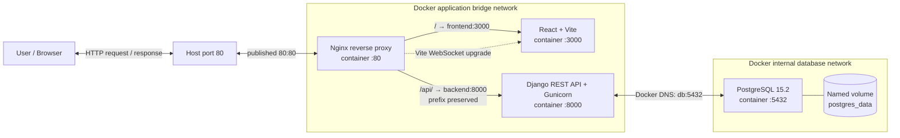

# Docker Full-Stack Infrastructure

A reproducible local demonstration of a four-service web application:
React/Vite, Django REST Framework, PostgreSQL, and Nginx, orchestrated with
Docker Compose. The task dashboard keeps application behavior intentionally
small so the networking, persistence, startup, and reverse-proxy design remain
the focus.

## 1. Project Overview

The browser reaches the application through Nginx on host port 80. Nginx
forwards `/api/` requests to Django and all other requests to the React/Vite
development server. Django stores tasks in PostgreSQL.

## 2. Assignment Requirements

The project includes the Compose file, Django and React Dockerfiles, Nginx
configuration, a Mermaid system diagram, environment template, and this
documentation. The four application services are `db`, `backend`, `frontend`,
and `nginx`.

## 3. Technology Stack

| Component | Technology |
|---|---|
| Database | PostgreSQL 15.2 |
| Backend | Django 4.2.27, Django REST Framework, Gunicorn |
| Frontend | React 19, Vite 6, Node.js 22 LTS |
| Reverse proxy | Nginx 1.27.5 Alpine |
| Orchestration | Docker Compose |

Image and package versions are pinned for a reproducible demo. Revisit pinned
versions regularly to apply security updates.

## 4. System Architecture

Nginx is the only service with a host-published application port. The app
network allows Nginx, React, and Django to communicate. The separate internal
database network contains only Django and PostgreSQL. Docker's embedded DNS
resolves service names such as `backend`, `frontend`, and `db`; no container
IP addresses are hardcoded.

## 5. Architecture Diagram



The source diagram is [diagrams/architecture.mmd](diagrams/architecture.mmd).
The frontend is intentionally run as a development server in this initial
four-service design. For production, React should normally be built to static
assets and served by a production web server instead.

## 6. Repository Structure

```text
.
├── backend/                 # Django API, migrations, and Dockerfile
├── diagrams/                # Mermaid architecture source
├── docs/                    # Troubleshooting reference
├── frontend/                # React/Vite dashboard and Dockerfile
├── nginx/                   # Reverse-proxy configuration
├── .env.example             # Local configuration template
├── docker-compose.yml
└── README.md
```

## 7. Prerequisites

- Docker Engine with Docker Compose v2 (`docker compose`)
- Git
- A free local TCP port 80

## 8. Environment Configuration

```sh
cp .env.example .env
```

Replace both placeholder credentials before starting. Generate a Django key
and database password locally, for example:

```sh
python -c 'import secrets; print(secrets.token_urlsafe(50))'
```

Run the command twice and use separate values for `DJANGO_SECRET_KEY` and
`POSTGRES_PASSWORD`. The `.env` file is ignored by Git; do not commit it.

## 9. Build and Deployment Instructions

```sh
docker compose config -q
docker compose up -d --build
docker compose ps
docker compose logs -f
```

The backend waits for PostgreSQL's health check, runs database migrations,
then starts Gunicorn. A migration failure exits the backend container and is
visible in its logs rather than being hidden.

## 10. Application Access

- Dashboard: <http://localhost/>
- Backend health: <http://localhost/api/health/>
- Task API: <http://localhost/api/tasks/>

## 11. API Endpoints

| Method | Path | Purpose |
|---|---|---|
| GET | `/api/health/` | Backend liveness response |
| GET | `/api/tasks/` | List tasks |
| POST | `/api/tasks/` | Create a task |
| GET | `/api/tasks/<id>/` | Retrieve one task |
| PATCH | `/api/tasks/<id>/` | Update task fields |
| DELETE | `/api/tasks/<id>/` | Delete a task |

Example:

```sh
curl http://localhost/api/health/
curl http://localhost/api/tasks/
curl -X POST http://localhost/api/tasks/ \
  -H 'Content-Type: application/json' \
  -d '{"title":"Test Docker Infrastructure","description":"Infrastructure assignment","completed":false}'
```

## 12. Docker Networking Design

- `application` is a bridge network for `nginx`, `frontend`, and `backend`.
- `database` is an internal bridge network for `backend` and `db` only.
- Django connects to PostgreSQL at `db:5432`, resolved by Docker DNS.
- Only Nginx publishes a host port (`80:80`). Backend, frontend, and database
  have no host-published ports.
- Compose `ports` publishes a container port on the host. `expose` documents
  an internal service port but does not publish it to the host.
- The internal database network prevents PostgreSQL from being directly
  reachable outside the Docker network.

## 13. Persistent Storage

PostgreSQL stores its data in the named volume `postgres_data`. Removing
containers with `docker compose down` retains this volume and its data.
`docker compose down -v` also removes the volume and permanently deletes the
database data stored in it.

## 14. Health Checks

PostgreSQL uses `pg_isready`; Django's lightweight health endpoint confirms
the API process responds; frontend probes the Vite HTTP server; and Nginx
validates its own configuration. Compose waits for a healthy database before
starting Django, and for healthy upstreams before starting Nginx. The API
health endpoint is a liveness check, not a database-readiness check.

## 15. Security Considerations

Secrets are supplied from an ignored local `.env`, Django debug mode is off
by default, the Django process runs as a non-root user, and only the reverse
proxy is exposed to the host. PostgreSQL has no published port and is placed
on an internal network. Containers do not use privileged mode or mount the
Docker socket.

This is a local HTTP demonstration, not a complete production deployment. It
does not configure TLS, production-grade secret management, or authentication.
The task API is intentionally open for local demonstration.

## 16. Testing and Validation

Run configuration validation and build:

```sh
docker compose config -q
docker compose build
docker compose up -d
docker compose ps
curl -I http://localhost/
curl http://localhost/api/health/
curl http://localhost/api/tasks/
```

Exercise task creation, update, and deletion:

```sh
curl -X POST http://localhost/api/tasks/ \
  -H 'Content-Type: application/json' \
  -d '{"title":"Persistence check","description":"Created through Nginx","completed":false}'
curl -X PATCH http://localhost/api/tasks/1/ \
  -H 'Content-Type: application/json' \
  -d '{"completed":true}'
curl -X DELETE http://localhost/api/tasks/1/
```

Use the ID returned by the create response instead of `1` when needed. To
check persistence, create a task, run `docker compose restart db`, and fetch
the task list again. PostgreSQL should not be reachable through a host port:

```sh
docker compose port db 5432
```

An empty result is expected because the database port is not published.
Commands in this section are validation instructions; run them in your
environment to confirm your Docker setup.

## 17. Troubleshooting

See [docs/troubleshooting.md](docs/troubleshooting.md) for diagnosis of
database connection failures, migrations, Nginx 502 responses, frontend API
errors, port conflicts, and container startup failures.

Useful commands:

```sh
docker compose ps
docker compose logs -f
docker compose logs backend
docker compose logs nginx
```

## 18. Cleanup Instructions

```sh
docker compose down
```

This stops and removes the containers and network but preserves `postgres_data`.
To also delete the database volume and all stored task data:

```sh
docker compose down -v
```

## 19. Design Decisions

- Four services keep the requested architecture explicit and understandable.
- Nginx preserves `/api/` when forwarding to Django, matching Django's routes.
- The browser uses same-origin relative API paths and never addresses Django
  directly.
- The database is isolated on a separate internal network and persists in a
  named volume.
- Startup health dependencies and migrations make first-run behavior
  predictable and failures visible.
- Vite is used as requested for this development-focused demonstration.

## 20. Production Improvement Recommendations

- Build React assets for production rather than running Vite's dev server.
- Add TLS termination, authentication, rate limiting, and stricter API
  permissions.
- Manage secrets using a dedicated secret manager.
- Add database backups, monitoring, log retention, and resource limits.
- Review and update dependency and image pins on a regular schedule.
